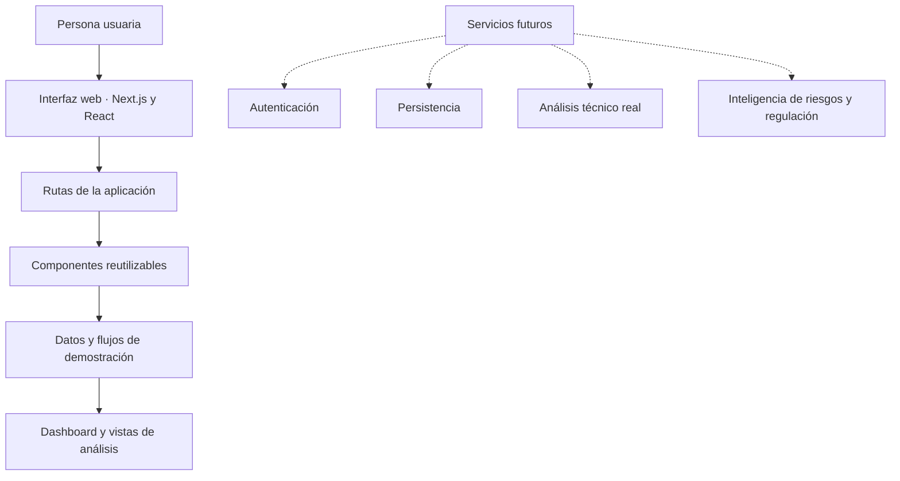

# PRIVACYOS

**Inteligencia para comprender la privacidad digital.**

PRIVACYOS es un prototipo de plataforma orientado a organizar información sobre privacidad digital y facilitar la revisión de las declaraciones de un servicio frente a señales técnicas disponibles. Su propuesta se centra en presentar los hallazgos de forma comprensible, con contexto y límites explícitos.

<p align="center">
  <a href="https://privacyos-59ot.vercel.app/"><strong>Ver aplicación</strong></a>
  ·
  <a href="https://github.com/catalinica1234-tech/privacyos/tree/main/docs"><strong>Documentación</strong></a>
</p>

## Descripción

La plataforma propone una lectura estructurada de tres elementos:

- **Declaraciones:** lo que un servicio comunica en sus políticas y documentación.
- **Señales observables:** información técnica disponible para contextualizar esas declaraciones.
- **Interpretación:** riesgos potenciales, referencias regulatorias y aspectos que requieren revisión.

Una diferencia entre una declaración y una señal no constituye, por sí sola, una prueba de incumplimiento. El propósito de la experiencia es organizar información y apoyar la revisión, no emitir un dictamen legal automático.

## Aplicación

**Demo pública:** [privacyos-59ot.vercel.app](https://privacyos-59ot.vercel.app/)

La versión actual corresponde a Foundation y utiliza datos de demostración. El flujo de escaneo y los resultados permiten recorrer la experiencia, pero no inspeccionan realmente el sitio web introducido ni ejecutan motores productivos de análisis.

## Funcionalidades de Foundation

- Página de presentación del producto.
- Vistas de inicio de sesión y registro con navegación demostrativa.
- Dashboard con datos de ejemplo.
- Escáner y pantalla de progreso en modo demostración.
- Historial y detalle de análisis de ejemplo.
- Secciones de riesgos, regulación y derechos de privacidad.
- Perfil y configuración.
- Componentes reutilizables y navegación adaptable.
- Tema claro y oscuro.

## Alcance técnico

Las siguientes capacidades no forman parte de la implementación funcional de Foundation:

- Autenticación real y gestión de sesiones.
- Persistencia en una base de datos.
- Inspección técnica de sitios web en tiempo real.
- Recolección automatizada de evidencia.
- Motores productivos de inteligencia artificial, riesgos o regulación.
- Cálculo productivo del Privacy Score.

Los valores mostrados en la interfaz son datos controlados para demostración. Introducir una URL no genera solicitudes ni análisis del sitio externo.

## Tecnologías

| Tecnología | Uso |
|---|---|
| Next.js 15 | Estructura de la aplicación y sistema de rutas |
| React 19 | Componentes e interacción de interfaz |
| TypeScript | Tipado estático |
| Tailwind CSS | Estilos y composición visual |
| Framer Motion | Animaciones de interfaz |
| Recharts | Visualizaciones de datos |
| Lucide React | Iconografía |
| Zod | Validación de esquemas |

## Estructura del repositorio

```text
privacyos/
├── app/                 # Rutas y páginas de la aplicación
├── components/          # Componentes reutilizables
├── lib/                 # Utilidades y datos compartidos
├── docs/                # Arquitectura y documentación del proyecto
├── public/              # Recursos estáticos
├── package.json         # Dependencias y comandos
└── README.md
```

## Documentación

- [Arquitectura de Foundation](docs/architecture-foundation.md)
- [Carta Gantt](docs/carta-gantt.md)
- [Contrato de equipo](docs/contrato-equipo.md)
- [Documentación de despliegue](docs/deployment.md)
- [Trazabilidad de requisitos](docs/requirements-traceability.md)
- [Auditoría técnica de Foundation](docs/audit-hito1-foundation.md)
- [Validación manual](docs/manual-validation-checklist.md)

## Equipo

| Integrante | Responsabilidades |
|---|---|
| **Catalina Romero** | Desarrollo frontend, integración y revisión técnica |
| **Melisa Ibáñez** | Documentación, investigación y propuesta de solución |
| **Simón Salgado** | Presentación, arquitectura y planificación |

## Ejecución local

### Requisitos

- Node.js 20 o superior.
- npm.

### Instalación

```bash
npm install
npm run dev
```

Abre [http://localhost:3000](http://localhost:3000) en el navegador.

### Comprobaciones disponibles

```bash
npm run lint
npm run typecheck
npm run build
```

Estos comandos permiten revisar lint, tipos y compilación. Sus resultados deben comprobarse en el entorno donde se ejecuten; la existencia de los scripts no implica que todas las comprobaciones estén aprobadas.

## Arquitectura de Foundation



El diagrama distingue la interfaz demostrativa de los servicios que corresponden a una evolución posterior del proyecto.

## Licencia

Este repositorio se desarrolla en el contexto académico del proyecto PRIVACYOS. No se ha especificado una licencia de distribución independiente.
